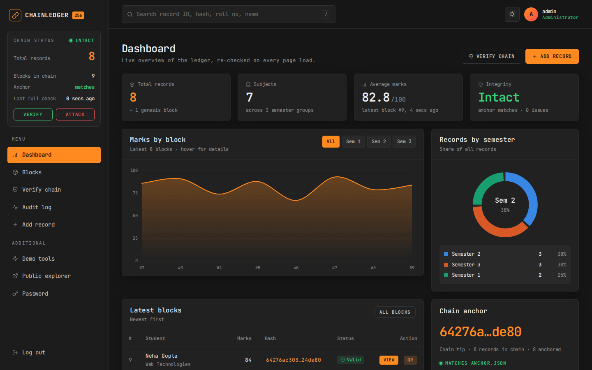
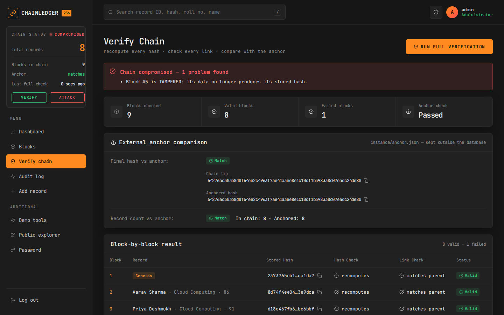
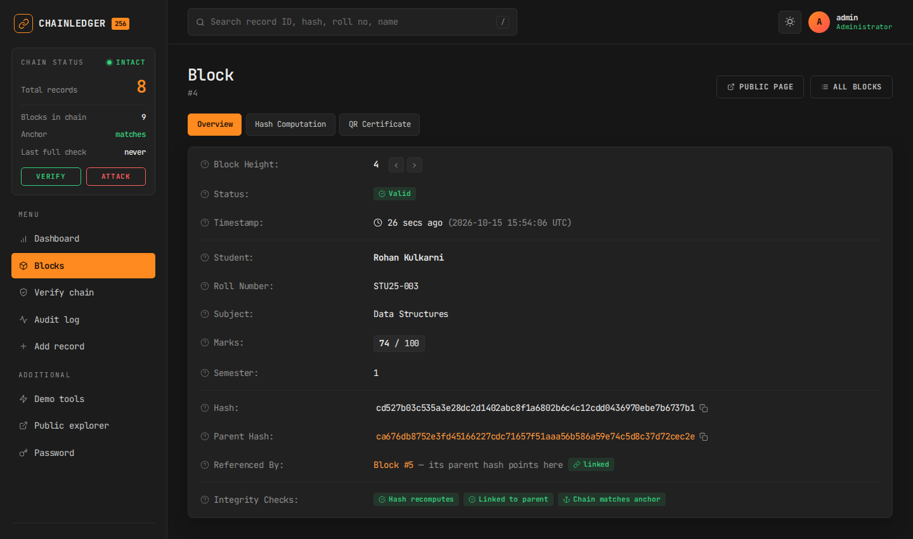
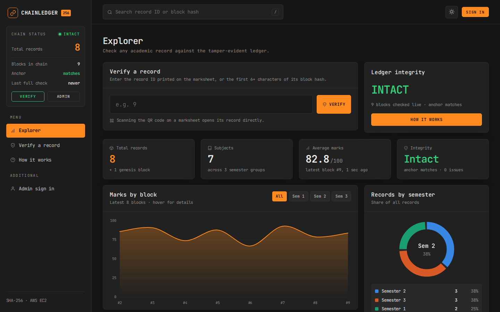
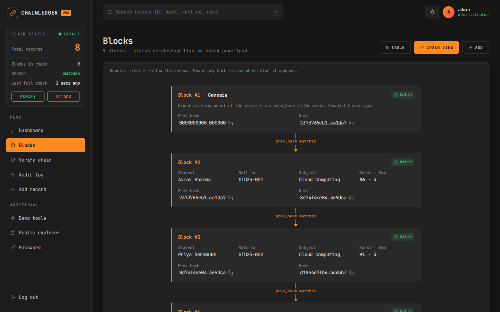
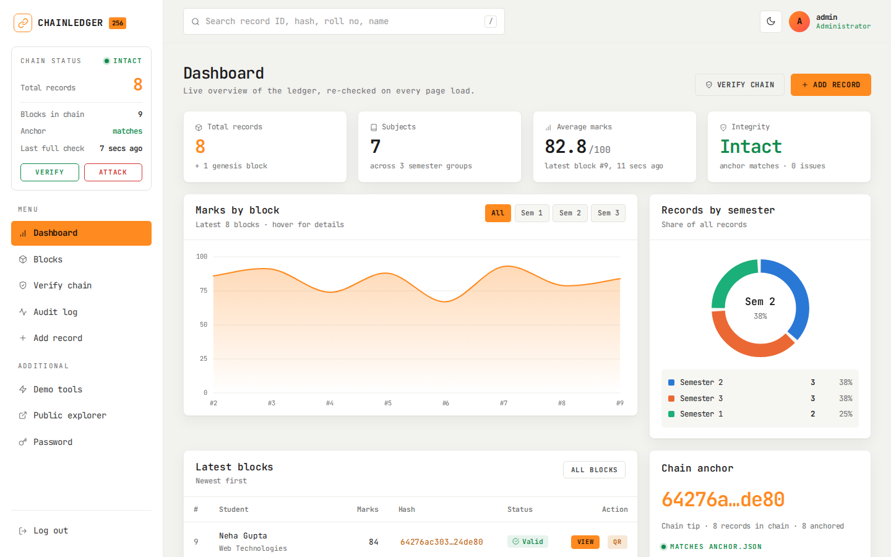
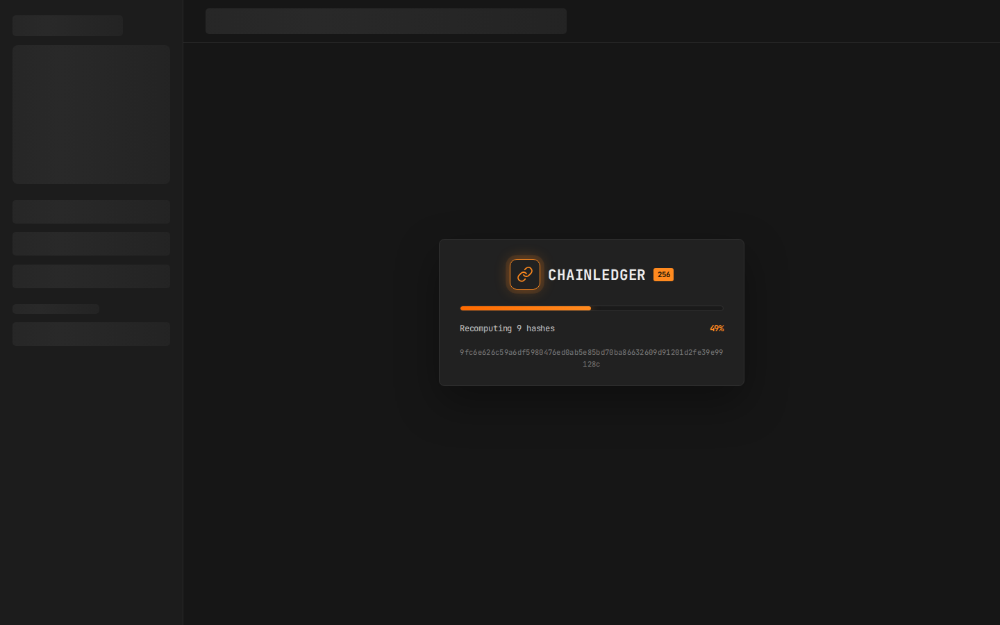
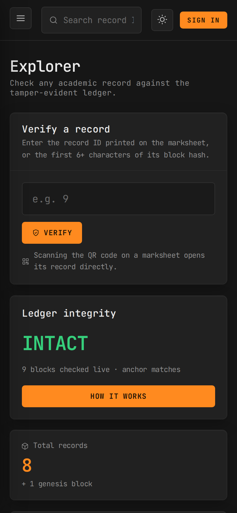

# ChainLedger – Tamper-Proof Academic Records Ledger


*Made by **Aryan Ayush***

Student marks are stored as a **blockchain-style chain of SHA-256 hashes**. If anyone edits, rebuilds or deletes a record directly in the database, the **Verify Chain** page detects it and shows exactly where the chain breaks.

It runs on your laptop (localhost) and on **one AWS EC2 Ubuntu server**. No other AWS service is used: no S3, no RDS, no Lambda.



## Quick start

```bash
git clone https://github.com/alucard1x/Chain-Record-ledger.git
cd Chain-Record-ledger
python3 -m venv venv && source venv/bin/activate     # Windows: py -m venv venv && venv\Scripts\activate
pip install -r requirements.txt
python init_db.py
python app.py
```

The site opens in your browser automatically at **http://127.0.0.1:5050**. Log in with `admin` / `admin123`. Full instructions for Windows, macOS and AWS EC2 are below.

## Contents

1. [How the hash chain works](#1-how-the-hash-chain-works)
2. [Features](#2-features)
3. [Screenshots](#screenshots)
4. [Folder structure](#3-folder-structure)
5. [Run on localhost](#4-run-on-localhost)
6. [Deploy on AWS EC2](#5-deploy-on-aws-ec2-step-by-step)
7. [Design notes and roadmap](#6-design-notes-and-roadmap)
8. [Security notes](#7-security-notes)

---

## 1. How the hash chain works

Think of each student record as a **sealed envelope** (a *block*). On every envelope we write a **fingerprint** of its contents: the SHA-256 hash. We also copy the **previous envelope's fingerprint** onto it.

```
┌──────────────┐     ┌──────────────┐     ┌──────────────┐
│ Block #1     │     │ Block #2     │     │ Block #3     │
│ GENESIS      │     │ Aarav · 86   │     │ Priya · 91   │
│ prev: 000…0  │ ──► │ prev: da31…  │ ──► │ prev: d479…  │
│ hash: da31…  │     │ hash: d479…  │     │ hash: 0674…  │
└──────────────┘     └──────────────┘     └──────────────┘
```

**The hash formula** (see `ledger.py`):

```
hash = SHA256( id | roll_no | student_name | subject | marks | semester | created_at | prev_hash )
```

- The **genesis block** (block #1) is created when the database is set up. Its `prev_hash` is 64 zeros.
- If someone changes marks from 74 to 99, the recomputed hash no longer equals the stored hash → **TAMPERED**.
- If a block is deleted, the next block's `prev_hash` points at a block that no longer exists → **BROKEN LINK**.

### The anchor (stops a clever hacker)

A clever hacker could change the marks **and then recompute every hash**, so every block looks perfect. To catch this, after every new record the app saves two values **outside the database** in `instance/anchor.json`:

- `latest_hash`: the hash of the newest block (the "tip" of the chain)
- `record_count`: how many student records there should be

A rebuilt chain ends with a **different final hash**, so verification reports **ANCHOR MISMATCH**. A deleted record changes the count, so it reports **RECORD COUNT MISMATCH**.

> **In real life** the anchor would be kept where a database attacker cannot reach it. For example, it could be emailed to an administrator after every update, printed on each certificate, or published somewhere public. ChainLedger keeps it in a separate file outside the database.

### What Verify Chain reports

| Result | Meaning |
|---|---|
| **VALID** | The hash recomputes correctly and `prev_hash` matches the previous block |
| **TAMPERED** | The data was changed: recomputed hash ≠ stored hash |
| **BROKEN LINK** | `prev_hash` ≠ previous block's hash (a block was removed or forged) |
| **ANCHOR MISMATCH** | The chain's final hash ≠ anchored hash (the chain was rebuilt) |
| **RECORD COUNT MISMATCH** | The number of records ≠ anchored count (a record was deleted) |

The app also **refuses to add new records to a chain that fails verification**. Otherwise a new anchor would be written and the evidence would be hidden.

---

## 2. Features

The interface is a **dark crypto-style dashboard** in charcoal and orange with one monospace font (JetBrains Mono). It has a left sidebar showing live chain status, summary cards, an area chart and a donut chart, and tables with action buttons. Every block also has a detail page with copy buttons and relative ages ("5 mins ago").

1. **Admin login.** Passwords are stored as salted PBKDF2-SHA256 hashes (werkzeug). The default login is `admin` / `admin123`. **Change it after your first login** from the username menu at top right.
2. **Explorer home / dashboard.** Both start with four summary cards: total records, subjects, average marks and integrity. They also show a **Marks by block** area chart, which you can filter by semester and hover for details, and a **Records by semester** donut. The public explorer adds a big **Verify a record** box. The admin dashboard adds **Latest blocks** (with View and QR buttons), a **Chain anchor** card and **Latest verifications**.
3. **Live status sidebar.** The sidebar on every page shows whether the chain is intact, the total records, the block count, whether the anchor matches and when the last full check ran. It turns red the moment someone tampers with the database. On phones it slides in from the menu button.
4. **Smart search.** One box on every page:
   - anyone can search by record ID or block hash (full, or the first 6+ characters)
   - admins can also search by roll number, student name or subject
5. **Add Record.** Takes roll no, name, subject, marks and semester, and creates a new block.
6. **Blocks page (the ledger), with two views.** The **Table** view lists blocks newest first, 25 per page. The **Chain view** shows connected block cards with arrows. **Hover any hash** and every copy of it on the page lights up, so you can see block N's hash sitting inside block N+1 as its parent hash.
7. **Block detail page, with three tabs.** **Overview** shows height (with ‹ › buttons to step through blocks), status, timestamp, the record, hash, parent hash, "Referenced By" and the three integrity checks. **Hash Computation** walks through the exact text that is hashed, the recomputed SHA-256 and the comparison, step by step. **QR Certificate** lets you download or print the QR code.
8. **Verify Chain.** One button re-checks everything. It shows a result banner, summary stats, the anchor comparison and a block-by-block table with hash and link checks.
9. **Public verification** (no login). Anyone can open a record by ID or by scanning its **QR code** and gets a verdict: Genuine, Not genuine, Warning or Not found. Student names are hidden from the public "Latest Blocks" list. The QR URL is built from the address you used, so it works on both localhost and the EC2 IP.
10. **Audit Log.** Every verification run, admin or public, is listed with its age, user, source and result, 25 per page.
11. **Demo tools** (in the sidebar, for demonstration only). These let you simulate tampering, simulate a hacker rebuild, simulate a deletion, and reset the demo.
12. **Light / dark theme.** Dark is the default. The sun and moon button in the top bar switches themes, and the browser remembers your choice. Press **/** anywhere to jump to the search box.

### Screenshots

| Tampering detected | Block detail |
|---|---|
|  |  |
| **Public explorer** (no login) | **Chain view** |
|  |  |
| **Light theme** | **Loading screen** |
|  |  |

<p align="center"></p>

---

## 3. Folder structure

```
ChainLedger/
├── app.py              Flask routes (all pages)
├── ledger.py           ★ Hashing, anchor and verification logic (the core of the project)
├── db.py               SQLite connection + table definitions
├── init_db.py          Creates tables, admin user, genesis block, 8 sample records
├── demo.py             Demo attacks (tamper / rebuild / delete / reset)
├── setup_mac.sh        One-command local setup for macOS/Linux
├── requirements.txt    Pinned Python packages
├── templates/          Jinja HTML pages
│   ├── base.html            Layout: loading screen, sidebar, top bar, footer
│   ├── home.html            Public explorer
│   ├── dashboard.html       Admin dashboard
│   ├── ledger.html, block.html, verify_chain.html, audit.html, demo.html, …
│   └── _kpis.html, _charts.html, _latest_table.html, _macros.html, _icons.html   (shared pieces)
├── static/
│   ├── css/style.css        Dashboard theme (charcoal + orange), light + dark
│   └── js/app.js            Loading screen, theme switch, area chart, copy buttons, hash highlight, tabs, signature
├── instance/           chainledger.db + anchor.json (created automatically, git-ignored)
├── deploy/
│   ├── setup.sh             One-shot EC2 installer
│   ├── chainledger.service  systemd unit (gunicorn on 127.0.0.1:8000)
│   └── nginx.conf           nginx reverse proxy (port 80 → gunicorn)
├── docs/screenshots/   Images used in this README
├── .gitignore / .gitattributes
└── README.md
```

---

## 4. Run on localhost

You need **Python 3.9 or newer**. Check with `python --version` (Windows) or `python3 --version` (macOS).

### Windows (Command Prompt)

```bat
cd C:\path\to\ChainLedger
py -m venv venv
venv\Scripts\activate
pip install -r requirements.txt
python init_db.py
python app.py
```

> Using **PowerShell** and the `activate` step fails with "running scripts is disabled"? Run `Set-ExecutionPolicy -Scope CurrentUser RemoteSigned` once, then `venv\Scripts\Activate.ps1`. You can also just use Command Prompt.

### macOS / Linux (Terminal)

**Shortcut:** `bash setup_mac.sh` finds Python, creates the venv, installs and checks every package, and creates the database in one go. Then run `source venv/bin/activate` and `python app.py`. Or do it by hand:

```bash
cd /path/to/ChainLedger
python3 -m venv venv
source venv/bin/activate
pip install -r requirements.txt
python init_db.py
python app.py
```

Your browser opens **http://127.0.0.1:5050** automatically. Log in with `admin` / `admin123`.

- To start the server without opening a browser, run `NO_BROWSER=1 python app.py` (macOS) or `set NO_BROWSER=1` first (Windows).
- Port **5050** is used because macOS uses port 5000 for AirPlay. To use another port, set the `PORT` variable, e.g. `set PORT=8080` on Windows or `PORT=8080 python app.py` on macOS.
- `python app.py` runs in **debug mode**, for local use only. On EC2 the app runs under gunicorn with debug **off**.
- **Next time** you only need to activate the venv (`venv\Scripts\activate` or `source venv/bin/activate`) and run `python app.py`.
- To start completely fresh, run `python init_db.py --reset`.

---

## 5. Deploy on AWS EC2 (step by step)

### Step 1: Launch the instance
1. Log in to the AWS Console → **EC2** → **Launch instance**.
2. **Name:** `chainledger`
3. **AMI:** *Ubuntu Server 24.04 LTS* (22.04 also works). This must be the 64-bit (x86) version.
4. **Instance type:** `t3.micro`
5. **Key pair:** click *Create new key pair*, name it `chainledger-key`, choose type RSA and format `.pem`, then **download it**. Keep this file safe, because you cannot download it again.
6. **Network settings** → *Create security group* with these rules:
   - **SSH (port 22):** source *My IP*. You connect through this port.
   - **HTTP (port 80):** source *Anywhere (0.0.0.0/0)*. Visitors open the website through this port.
7. **Storage:** the default 8 GB gp3 (EBS) is enough.
8. Click **Launch instance**. Then open the instance and copy its **Public IPv4 address**.

### Step 2: Connect with SSH

**Windows (PowerShell, where ssh is built in):**
```powershell
cd $HOME\Downloads
icacls chainledger-key.pem /inheritance:r
icacls chainledger-key.pem /grant:r "$($env:USERNAME):(R)"
ssh -i chainledger-key.pem ubuntu@<EC2-public-IP>
```

**macOS / Linux:**
```bash
chmod 400 ~/Downloads/chainledger-key.pem
ssh -i ~/Downloads/chainledger-key.pem ubuntu@<EC2-public-IP>
```
Type `yes` when asked about the fingerprint.

### Step 3: Upload the project folder

**Option A: GitHub (easiest).** Push this folder to a GitHub repository (`instance/` and `venv/` are git-ignored automatically). Then run on the server:
```bash
git clone https://github.com/alucard1x/Chain-Record-ledger.git ~/chainledger
```

**Option B: copy it directly with scp.** Run this on your laptop, **not** in the SSH window. First delete your local `venv` folder to keep the upload small. It will not work on Linux anyway.
```bash
# run from the folder that CONTAINS ChainLedger
scp -i chainledger-key.pem -r ChainLedger ubuntu@<EC2-public-IP>:~/chainledger
```
On macOS/Linux you can skip the venv and your local data without deleting anything:
```bash
rsync -av -e "ssh -i ~/Downloads/chainledger-key.pem" --exclude venv --exclude instance ChainLedger/ ubuntu@<EC2-public-IP>:~/chainledger/
```

### Step 4: Run the setup script (on the server)
```bash
cd ~/chainledger
bash deploy/setup.sh
```
The script takes 2 to 3 minutes. It does the following:
- installs python3-venv, nginx, git and sqlite3
- creates a virtualenv and installs the requirements
- generates a random `SECRET_KEY` and stores it in `/etc/chainledger.env`
- runs `init_db.py`
- starts **gunicorn** as a systemd service on `127.0.0.1:8000`
- configures **nginx** to forward port 80 to gunicorn

At the end it prints your URL.

> If you edited `setup.sh` on Windows and see `$'\r': command not found`, run `sed -i 's/\r$//' deploy/setup.sh` and try again.

### Step 5: Open the website
Go to **http://&lt;EC2-public-IP&gt;** (use http, not https). Log in, then **change the admin password** straight away.

### Useful server commands
```bash
sudo systemctl status chainledger       # is the app running?
sudo journalctl -u chainledger -f       # live logs (Ctrl+C to exit)
sudo systemctl restart chainledger      # after uploading new code
cd ~/chainledger && venv/bin/python init_db.py --reset   # fresh demo data
```

### ⚠ Important notes
- **The public IP changes** every time you **stop and start** the instance. Always copy the new IP from the EC2 console. The QR codes adapt automatically because they are built from the address you use, but QR codes printed earlier will point to the old IP. An Elastic IP would keep the address fixed, but it is billed when the instance is stopped.
- **Stop the instance when you are not using it** to avoid paying for idle time: EC2 → select instance → *Instance state* → **Stop**. Your data stays on the EBS disk. **Terminate** the instance only when you no longer need it, because terminating deletes everything.
- The site uses plain HTTP, which is fine for testing. For real use, add a domain and HTTPS (e.g. Let's Encrypt).

---

## 6. Design notes and roadmap

**Is this a real blockchain?** No. It is a *blockchain-style* hash chain on a single server, with no distributed network, consensus or mining. Tamper **evidence** comes from the hashes and the anchor: it cannot stop someone with database access from changing data, but it always detects the change.

**Try an attack yourself.** Besides the built-in Demo tools, you can edit the database directly and watch Verify Chain catch it:
```bash
sqlite3 instance/chainledger.db "UPDATE records SET marks=99 WHERE id=4;"
```

**Current limitations:** a single server with no replication, the anchor file lives on the same machine, SQLite suits low traffic, plain HTTP, and a single admin role.

**Roadmap:**
- email or publish the anchor automatically after every change
- HTTPS with a custom domain
- digitally signed PDF certificates
- multiple admin roles with different permissions
- scheduled EBS snapshots for backup
- anchoring the chain tip on a public blockchain

---

## 7. Security notes

- Passwords are stored as salted hashes, never in plain text.
- All forms carry a CSRF token.
- The session cookie is HttpOnly and signed with `SECRET_KEY`. On the server this key comes from `/etc/chainledger.env`, with a random value generated by `setup.sh`.
- Debug mode is only on for `python app.py` on your laptop.
- The Demo Tools deliberately damage data. They require an admin login and are labelled "for demonstration only".

---

<p align="center"><i>Made by Aryan Ayush</i></p>
